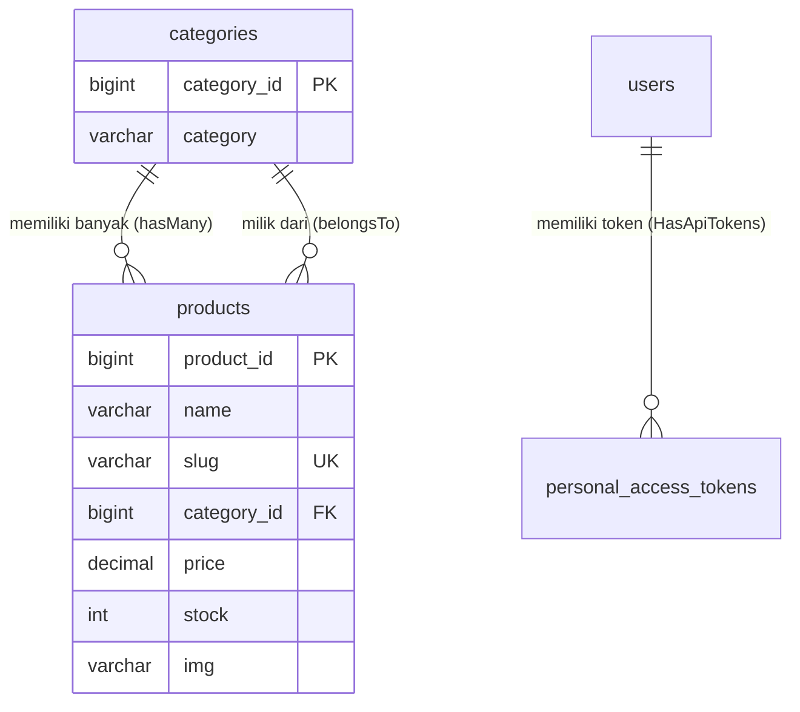

# Walkthrough Teknis Pengembangan & Pengujian Backend BroilerHub

Dokumen ini merupakan panduan teknis langkah demi langkah mengenai cara kerja, alur implementasi, serta metode pengujian backend RESTful API **BroilerHub**. Panduan ini disusun berdasarkan pengalaman pengerjaan proyek nyata mengacu pada materi **Praktikum BAB III REST API**.

---

## 1. Verifikasi Lingkungan (Prerequisites)

Sebelum menjalankan perintah apa pun, pastikan perangkat pengembangan memiliki versi bahasa pemrograman dan tool yang kompatibel.

Jalankan perintah berikut di terminal:
```bash
php -v
composer -V
```

Pada lingkungan proyek ini, versi yang terverifikasi adalah:
- **PHP:** `8.3.33` (ZTS Visual C++ 2019 x64)
- **Composer:** `2.10.2`

Pastikan pula service MySQL (misalnya melalui Laragon atau XAMPP) sudah aktif dan mendengarkan port default `3306`.

---

## 2. Instalasi Dependency Proyek

Proyek ini menggunakan paket resmi Laravel Framework dan Laravel Sanctum untuk manajemen token autentikasi.

Untuk mengunduh dan menyinkronkan seluruh paket vendor:
```bash
composer install
```

Paket utama yang terdaftar pada `composer.json`:
- `laravel/framework: ^13.17`
- `laravel/sanctum: ^4.3` (mengelola Personal Access Token)
- `laravel/tinker: ^3.0`

---

## 3. Konfigurasi Koneksi Database (`.env`)

Laravel mengelola koneksi database melalui konfigurasi di `config/database.php` yang membaca nilai dinamis dari file `.env`.

Pastikan baris konfigurasi database pada `.env` telah disesuaikan:
```dotenv
DB_CONNECTION=mysql
DB_HOST=127.0.0.1
DB_PORT=3306
DB_DATABASE=laraveltoko
DB_USERNAME=root
DB_PASSWORD=
```

Untuk memverifikasi koneksi database tanpa membuka data kredensial, jalankan:
```bash
php artisan db:show
```
Jika status menampilkan informasi tabel dan koneksi `mysql` terhubung, artinya konfigurasi sudah benar.

---

## 4. Migrasi Skema & Pengisian Seeder Idempotent

### A. Struktur Tabel Migration
Tabel pada backend BroilerHub dibangun melalui file migrasi di folder `database/migrations/`:
1. `0001_01_01_000000_create_users_table.php`: Menyimpan data akun (`id`, `name`, `email`, `password`, `timestamps`).
2. `2026_10_19_133526_create_categories_table.php`: Menyimpan kategori (`category_id` sebagai PK autoincrement, `category`, `timestamps`).
3. `2026_10_19_133557_create_products_table.php`: Menyimpan katalog produk (`product_id` sebagai PK, `name`, `description`, `category_id` sebagai FK dengan `onDelete('cascade')`, `price`, `stock`, `slug` unik, `img`, `timestamps`).
4. `2026_10_24_000001_create_personal_access_tokens_table.php`: Menyimpan token login Sanctum (`id`, `tokenable_type`, `tokenable_id`, `name`, `token`, `abilities`, `timestamps`).

> **Keputusan Teknis:** Pada file migrasi `create_categories_table` dan `create_products_table`, diterapkan guard `if (!Schema::hasTable(...))` untuk mencegah terjadinya galat *table already exists* jika tabel fisik sudah pernah dibuat sebelumnya. Dengan cara ini, migrasi dapat berjalan aman tanpa harus menggunakan perintah destruktif seperti `migrate:fresh`.

Jalankan migrasi:
```bash
php artisan migrate
```

Cek status seluruh migrasi:
```bash
php artisan migrate:status
```
Seluruh migrasi harus berstatus `Ran`.

### B. Seeder BroilerHub yang Aman & Idempotent
Seeder dirancang untuk mengisi data katalog ayam broiler yang relevan dengan bisnis peternakan.
- [`CategorySeeder.php`](file:///c:/laravel-projects/Broilerhub-laravel/database/seeders/CategorySeeder.php): Menggunakan `Category::firstOrCreate` untuk 5 kategori:
  1. *Ayam Hidup Siap Panen*
  2. *Karkas Broiler Segar*
  3. *Ayam Broiler Parting*
  4. *Fillet & Boneless Broiler*
  5. *By-Product & Organ Unggas*
- [`ProductSeeder.php`](file:///c:/laravel-projects/Broilerhub-laravel/database/seeders/ProductSeeder.php): Menggunakan `Product::updateOrCreate` berbasis `slug` unik untuk 10 produk broiler (ayam hidup standar/jumbo, karkas utuh 1.2 kg dan 1.6 kg, dada/paha fillet, ayam parting potong 8, sayap, dan ceker bersih).
- [`DatabaseSeeder.php`](file:///c:/laravel-projects/Broilerhub-laravel/database/seeders/DatabaseSeeder.php): Menyediakan akun admin default `admin@broilerhub.com` (password: `password123`) serta akun uji praktikum `test@example.com`.

Jalankan seeder:
```bash
php artisan db:seed
```
Karena menggunakan `firstOrCreate` dan `updateOrCreate`, perintah ini aman dijalankan berulang kali tanpa membuat data duplikat.

---

## 5. Model Eloquent & Relasi Antar Tabel

BroilerHub menerapkan relasi *One-to-Many* antara Kategori dan Produk:



### A. Model `Category` (`app/Models/Category.php`)
```php
class Category extends Model
{
    use HasFactory;

    protected $primaryKey = 'category_id';
    protected $fillable = ['category'];

    public function products(): HasMany
    {
        return $this->hasMany(Product::class, 'category_id', 'category_id');
    }
}
```

### B. Model `Product` (`app/Models/Product.php`)
```php
class Product extends Model
{
    use HasFactory;

    protected $primaryKey = 'product_id';
    protected $fillable = [
        'name', 'slug', 'description', 'category_id', 'price', 'img', 'stock',
    ];

    protected function casts(): array
    {
        return [
            'price' => 'float',
            'stock' => 'integer',
        ];
    }

    public function category(): BelongsTo
    {
        return $this->belongsTo(Category::class, 'category_id', 'category_id');
    }
}
```

### C. Model `User` (`app/Models/User.php`)
Menyertakan trait `HasApiTokens` dari Laravel Sanctum serta melindungi atribut sensitif:
```php
class User extends Authenticatable
{
    use HasApiTokens, HasFactory, Notifiable;

    protected $fillable = ['name', 'email', 'password'];
    protected $hidden = ['password', 'remember_token'];
}
```

---

## 6. Arsitektur Route, Form Request, & API Resource

### A. Pendaftaran Rute API di Laravel 13
Pada Laravel versi 11 ke atas, file `routes/api.php` didaftarkan secara eksplisit di file [`bootstrap/app.php`](file:///c:/laravel-projects/Broilerhub-laravel/bootstrap/app.php):
```php
return Application::configure(basePath: dirname(__DIR__))
    ->withRouting(
        web: __DIR__.'/../routes/web.php',
        api: __DIR__.'/../routes/api.php',
        commands: __DIR__.'/../routes/console.php',
        health: '/up',
    )
    ->withExceptions(function (Exceptions $exceptions): void {
        $exceptions->shouldRenderJsonWhen(
            fn (Request $request) => $request->is('api/*') || $request->expectsJson(),
        );
    })->create();
```
Konfigurasi `shouldRenderJsonWhen` memastikan setiap respon galat pada path `/api/*` selalu dikembalikan dalam bentuk JSON murni, bukan tampilan halaman web HTML.

### B. Validasi Input Terpisah (Form Request)
Untuk menjaga agar controller tetap ramping (*skinny controller*), seluruh aturan validasi dipisahkan ke dalam folder `app/Http/Requests/`:
- **`StoreProductRequest` & `UpdateProductRequest`:** Memeriksa field `name`, ketersediaan `category_id` di database (`exists:categories,category_id`), tipe data harga (`numeric`), stok (`integer`), keunikan slug, serta validasi berkas gambar (`image|mimes:jpg,jpeg,png|max:2048`).
- **`StoreCategoryRequest` & `UpdateCategoryRequest`:** Memeriksa keunikan nama kategori.
- **`RegisterRequest` & `LoginRequest`:** Memeriksa format email, keunikan user, dan panjang password.

### C. Standarisasi Respon (API Resource)
Penggunaan Resource di `app/Http/Resources/` menjamin keseragaman format data JSON:
- [`ProductResource.php`](file:///c:/laravel-projects/Broilerhub-laravel/app/Http/Resources/ProductResource.php) memetakan `product_id` menjadi `id`, mengkonversi angka harga dan stok, serta menghasilkan `img_url` lengkap via `url('storage/' . ltrim($this->img, '/'))`.

---

## 7. Pengujian Operasi CRUD Produk

### A. Read (Daftar Produk)
- **Method & URL:** `GET http://127.0.0.1:8000/api/products`
- **Akses:** Publik (tidak memerlukan token)
- **Implementasi:** Menggunakan eager loading `Product::with('category')` sehingga tidak terjadi pemborosan query database (N+1 query issue).

### B. Read (Detail Produk)
- **Method & URL:** `GET http://127.0.0.1:8000/api/products/2`
- **Respon Sukses (200 OK):**
```json
{
    "data": {
        "id": 2,
        "name": "Ayam Broiler Hidup Standar (1.6 - 1.8 kg)",
        "slug": "ayam-broiler-hidup-standar-16-18-kg",
        "price": 21500,
        "stock": 4500,
        "img": "products/broiler-hidup-standar.jpg",
        "img_url": "http://127.0.0.1:8000/storage/products/broiler-hidup-standar.jpg",
        "category": {
            "id": 5,
            "name": "Ayam Hidup Siap Panen"
        }
    }
}
```

### C. Create (Tambah Produk)
- **Method & URL:** `POST http://127.0.0.1:8000/api/products`
- **Akses:** Memerlukan Header `Authorization: Bearer <token>`
- **Body:** JSON atau `multipart/form-data`
- **Respon (201 Created):** Mengembalikan objek produk baru beserta status HTTP 201.

### D. Update Produk
- **Method & URL:** `PUT http://127.0.0.1:8000/api/products/{id}`
- **Akses:** Memerlukan Bearer Token
- **Body JSON:**
```json
{
    "name": "Ayam Broiler Hidup Standar (Grade Super)",
    "price": 22500,
    "stock": 4000
}
```

### E. Delete Produk
- **Method & URL:** `DELETE http://127.0.0.1:8000/api/products/{id}`
- **Akses:** Memerlukan Bearer Token
- **Respon (200 OK):**
```json
{
    "message": "Product deleted successfully"
}
```

---

## 8. Pengujian Fitur Pencarian, Filter, Sorting, & Paginasi

Fitur ini diimplementasikan di dalam method `index()` pada `ProductController`:

1. **Pencarian Nama & Deskripsi:**
   `GET /api/products?search=karkas`
   *(Query builder mencocokkan kata kunci pada kolom `name` atau `description`)*.
2. **Filter Kategori:**
   `GET /api/products?category_id=5`
3. **Filter Rentang Harga:**
   `GET /api/products?min_price=20000&max_price=35000`
4. **Pengurutan (Sorting):**
   `GET /api/products?sort_by=price&order=desc`
   *(Kolom yang diizinkan dibatasi melalui whitelist: `product_id`, `name`, `price`, `stock`, `created_at`)*.
5. **Paginasi Dinamis:**
   `GET /api/products?page=1&per_page=5`
   *(Batas maksimal `per_page` dibatasi maksimal 50 untuk menjaga performa)*.

---

## 9. Manajemen File Gambar Produk (Upload, Update, & Cleanup)

### A. Lokasi Penyimpanan Fisik
Berkas gambar diunggah ke storage lokal pada disk `public` di dalam subfolder `products`:
- Path penyimpanan: `storage/app/public/products/`
- Akses melalui link simbolik: `public/storage/products/`

### B. Mekanisme Upload Baru (Store)
Saat request `POST /api/products` membawa berkas pada field `img`:
```php
if ($request->hasFile('img')) {
    $uploadedPath = $request->file('img')->store('products', 'public');
    $validated['img'] = $uploadedPath;
}
```
**Pencegahan File Yatim (Orphan File Prevention):** Jika setelah file disimpan ke disk terjadi kegagalan query database (misalnya database mati atau constraint error), blok `try ... catch` pada controller akan otomatis menghapus file yang baru diunggah tersebut:
```php
if ($uploadedPath && Storage::disk('public')->exists($uploadedPath)) {
    Storage::disk('public')->delete($uploadedPath);
}
```

### C. Pergantian Gambar (Update via Method Spoofing)
Karena protokol PHP native tidak memparsing data `multipart/form-data` pada request HTTP `PUT`, pembaruan berkas gambar dilakukan dengan mengirim request **`POST`** disertai field teks `_method = PUT`:
- Gambar baru diunggah ke direktori `products/`.
- Perubahan disimpan ke database.
- Jika database berhasil diupdate, file gambar lama yang sebelumnya digunakan otomatis dihapus dari disk:
```php
if ($uploadedPath && !empty($oldImagePath) && $oldImagePath !== $uploadedPath) {
    if (Storage::disk('public')->exists($oldImagePath)) {
        Storage::disk('public')->delete($oldImagePath);
    }
}
```

### D. Pembersihan Gambar Saat Produk Dihapus (Destroy)
Saat memanggil `DELETE /api/products/{id}`, controller mengambil path gambar produk terlebih dahulu, menghapus record database, lalu menghapus file fisiknya dari disk publik.

---

## 10. Pengujian Autentikasi Laravel Sanctum

### A. Registrasi Pengguna
- **Endpoint:** `POST /api/register`
- **Request Body:**
```json
{
    "name": "Budi Santoso",
    "email": "budi@broilerhub.com",
    "password": "password123"
}
```
- **Respon (201 Created):**
```json
{
    "message": "Register success",
    "user": {
        "id": 3,
        "name": "Budi Santoso",
        "email": "budi@broilerhub.com"
    },
    "token": "13|a8BcDeFgHiJk...",
    "token_type": "Bearer"
}
```
> **Keamanan:** Password di-hash menggunakan `Hash::make()` sebelum disimpan. Atribut `$hidden` pada model `User` memastikan password dan hash-nya tidak pernah dibocorkan pada respon JSON.

### B. Login Pengguna
- **Endpoint:** `POST /api/login`
- **Request Body:**
```json
{
    "email": "admin@broilerhub.com",
    "password": "password123"
}
```
Jika password salah, controller melempar `ValidationException` yang menghasilkan respon standar:
```json
{
    "message": "Invalid credentials.",
    "errors": {
        "email": ["Invalid credentials."]
    }
}
```
*(Status HTTP: `422 Unprocessable Content`)*.

### C. Mengakses Profil Terproteksi
- **Endpoint:** `GET /api/profile`
- **Header Wajib:** `Authorization: Bearer <token_hasil_login>`
- Respon (200 OK) menampilkan data akun user terkait.

### D. Logout Selektif
- **Endpoint:** `POST /api/logout`
- **Header Wajib:** `Authorization: Bearer <token_hasil_login>`
- **Logika:** Menghapus hanya token yang sedang digunakan pada request tersebut:
  `$request->user()->currentAccessToken()->delete();`
- Jika token tersebut dicoba kembali setelah logout, server langsung merespon **`401 Unauthorized`** (`{"message": "Unauthenticated."}`).

---

## 11. Menjalankan Pengujian Melalui Postman

### A. Impor File Postman
1. Buka aplikasi **Postman**.
2. Klik tombol **Import** di kiri atas.
3. Masukkan dua berkas dari direktori proyek:
   - [`postman/BroilerHub-API.postman_collection.json`](file:///c:/laravel-projects/Broilerhub-laravel/postman/BroilerHub-API.postman_collection.json)
   - [`postman/BroilerHub-Environment.postman_environment.json`](file:///c:/laravel-projects/Broilerhub-laravel/postman/BroilerHub-Environment.postman_environment.json)
4. Pastikan environment aktif di kanan atas adalah **BroilerHub Local Environment**.

### B. Urutan Eksekusi Pengujian
Jalankan request secara berurutan sesuai folder:
1. **Folder `1. Authentication`:**
   Jalankan `Login - Valid Credentials (200 OK)`. Token Sanctum otomatis disimpan ke variabel `{{token}}`.
2. **Folder `2. Categories`:**
   Uji `Get All Categories`, `Get Category Detail`, `Create Category`, `Update Category`, dan `Delete Category`.
3. **Folder `3. Products CRUD`:**
   Uji alur baca katalog, lihat detail produk, tambah produk baru ber-token, update, dan hapus produk.
4. **Folder `4. Product Search and Filters`:**
   Uji parameter pencarian, filter kategori, rentang harga, sort descending, dan batasan pagination.
5. **Folder `5. File Upload`:**
   Pilih file gambar nyata pada request `Upload Product Image`, jalankan `Update Product Image` untuk menguji penghapusan file lama, lalu jalankan `Delete Uploaded Product`.
6. **Folder `6. Authorization and Error Handling`:**
   Uji request tanpa token (401), token invalid (401), ID tidak ditemukan (404), dan input tidak valid (422).

---

## 12. Panduan Mengatasi Kendala Umum (Troubleshooting)

| Gejala Galat | Penyebab Masalah | Solusi Penanganan |
| :--- | :--- | :--- |
| `SQLSTATE[HY000] [2002] Connection refused` | Service MySQL belum berjalan di komputer lokal. | Nyalakan service MySQL pada Laragon atau XAMPP control panel. |
| Respon `401 Unauthenticated` pada request produk | Endpoint `POST/PUT/DELETE` diproteksi middleware `auth:sanctum` dan belum menyertakan token. | Jalankan request `Login` terlebih dahulu untuk memperbarui variabel `{{token}}`. |
| Upload gambar pada operasi `PUT` tidak terbaca | PHP native tidak mendukung pembacaan berkas multipart pada method HTTP `PUT`. | Kirim request menggunakan method `POST` dan tambahkan field teks `_method` bernilai `PUT`. |
| Gambar produk menghasilkan link 404 saat dibuka | Direktori symlink `public/storage` belum terhubung ke storage fisik. | Jalankan perintah `php artisan storage:link` di terminal. |
| Galat `Table 'categories' already exists` saat migrasi | Tabel fisik sudah ada sebelum file migrasi tercatat di batch migration. | Skrip migrasi BroilerHub telah dilengkapi guard `if (!Schema::hasTable(...))`. Cukup jalankan `php artisan migrate` biasa. |

